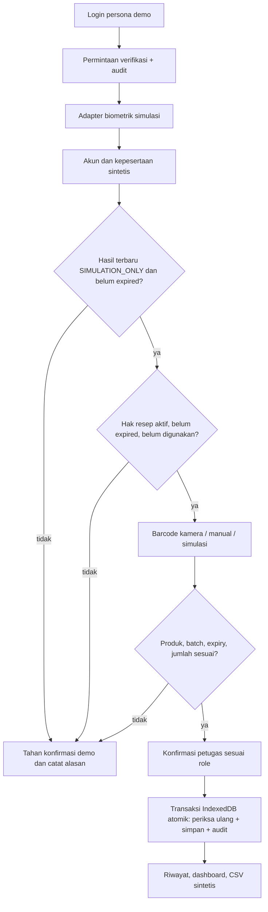
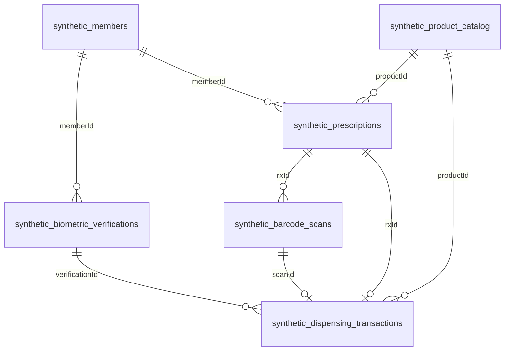

# Validasi penyerahan JELAS

## Audit dan keputusan arsitektur

Sebelum perubahan: React 19 + TypeScript + Vite 7 + Tailwind 4; routing lazy React Router; Dexie untuk kasus/audit lokal, Zod untuk backup; workbench PRB/CAPD/risk engine, portal mobile, autentikasi persona demo, service worker, ekspor/impor. Tidak ada backend atau integrasi resmi. Fitur ini dipertahankan. Modul baru berada di `/desktop/dispensing` dan memakai database `jelas-synthetic-dispensing-v1`, terpisah dari database kasus lama.

Temuan yang ditangani:

- Modul lama belum memiliki transaksi identitas → hak → produk. Service baru memeriksa ketiganya secara independen.
- Belum ada idempotensi penyerahan. Penyimpanan snapshot dan audit memakai satu transaksi IndexedDB read/write, termasuk antar-tab. Pemeriksaan ulang dilakukan saat commit, bukan hanya saat tombol diaktifkan.
- `npm test` sebelumnya hanya typecheck. Sekarang menjalankan pengujian domain dan suite lama; pengujian browser terpisah menguji interaksi nyata.
- Cache lama hanya menyimpan chunk yang pernah dibuka; route lazy belum tentu tersedia offline. Build sekarang menghasilkan manifest semua JS/CSS/HTML dan service worker melakukan precache. Service worker tidak didaftarkan dalam development.
- Sidebar bertambah panjang: daftar menu dibuat dapat digulir.

Batas yang tetap berlaku: autentikasi/role lama dapat dipilih bebas untuk demo; localStorage dapat dimanipulasi. IndexedDB dan audit lokal juga dapat diubah melalui devtools. Tidak ada klaim autentikasi, otorisasi, immutability, atau nonrepudiation produksi. Modul baru memeriksa role pada UI dan service; ini bukan pengerasan seluruh modul warisan. Penilaian risiko lama tidak diubah menjadi penentu hak penyerahan.

## Alur

Pembatasan tidak boleh digunakan untuk menolak layanan nyata atau menghambat keadaan emergensi. Semua hasil hanya simulasi administrasi. Tidak ada template biometrik, foto, NIK, nomor kartu JKN, password, atau access token yang dimasukkan ke dataset baru.

## Skema dan relasi

`src/lib/dispensing/domain.ts` adalah kontrak Zod yang dijalankan saat pembacaan, mutasi, dan ekspor. `dictionary.ts` memuat definisi semua kolom, kategori manfaat, ketergantungan, dan konsekuensi jika tidak tersedia. Keduanya ditampilkan pada Data Explorer dan Evaluasi Data.

`synthetic_audit_logs.entityId` menunjuk objek terkait; `correlationId` menghubungkan permintaan/hasil. Semua tabel wajib `mode=SIMULATION_ONLY`; semua ID berpola `DEMO-*`. `VERIFIED` tersedia dalam kontrak status untuk desain integrasi, tetapi provider yang mengembalikan VERIFIED ke alur demo ditolak. Hasil gagal, pending, expired, dan requires_review tidak dapat dipakai untuk commit. Permintaan verifikasi yang lebih baru membatalkan kelayakan hasil lama, termasuk ketika provider baru masih menunggu.

Generator `seed(at)` menghasilkan 4 peserta, 3 produk, dan 9 hak. Tabel kejadian awal kosong dan terisi melalui alur fungsional, bukan angka dashboard buatan. Peserta 1 memenuhi akun/kepesertaan demo; peserta 2 tidak eligible; peserta 3 tidak memenuhi kepemilikan akun; hak peserta 4 expired/cancelled. RX-0009 adalah cairan sintetis kedaluwarsa. Produk dan dosis bukan rekomendasi klinis.

### Mengganti dataset

1. Ubah generator `seed()` dan skema Zod bila diperlukan, gunakan identitas sintetis saja. Tambahkan kasus uji sebelum mengubah aturan.
2. Dataset lama tidak ditimpa otomatis. Untuk fixture pengujian gunakan `new MemoryStore(seed(waktuISO))` yang terisolasi.
3. Untuk menginisialisasi ulang demonstrasi browser, ekspor CSV yang diperlukan terlebih dahulu lalu hapus **hanya** database `jelas-synthetic-dispensing-v1` melalui devtools dan muat ulang. Ini menghapus data demo lokal; database kasus lama terpisah. Untuk migrasi yang dipertahankan, tambah versi Dexie dan migrasi eksplisit.
4. Jangan mengimpor data produksi ke store ini. Tidak tersedia import umum untuk mencegah pencampuran data.

## Kebijakan transaksi demo

- Role penyerahan PRB: Apoteker FKTP/Admin Demo; dialisis: Perawat CAPD/Admin Demo. Verifikator dapat memverifikasi tetapi tidak menyerahkan. DPJP/Komite Medik membaca.
- Hasil verifikasi dan scan berlaku 15 menit. Akun dan eligible diperiksa kembali terhadap fixture sumber, bukan barcode.
- Satu hak hanya satu transaksi, termasuk jumlah lebih kecil daripada hak. **Tidak ada pengambilan sisa otomatis**. Kebijakan final harus disetujui pemilik layanan.
- Idempotency key sama + payload sama mengembalikan transaksi lama; payload berbeda ditolak. Key baru terhadap hak yang telah dipakai ditolak dan diaudit.
- Transaksi dibatalkan tetap mengunci hak. Pembukaan kembali harus menjadi proses resmi tersendiri.
- Batch/expiry berasal dari katalog fixture, bukan ekstraksi GS1 dari label. Demo memakai kode `DEMO-BC-*`. Kamera mendeteksi format sesuai browser: Code 128/39, EAN/UPC, Data Matrix, QR; input manual selalu tersedia. GS1 AI (01)/(10)/(17), serialisasi, normalisasi GTIN, dan adapter hardware memerlukan spesifikasi resmi.
- Batch wajib dan minimum masa simpan dapat diatur terpisah PRB/dialisis; default hanya contoh, bukan aturan klinis yang disahkan.
- Retensi 1–365 hari dioperasikan manual oleh Admin Demo. Penghapusan kejadian lama menghapus referensi hak yang telah dipakai supaya tidak terbuka kembali; referensi verifikasi/scan transaksi yang masih disimpan dipertahankan. Peserta/katalog sintetis tetap ada. Audit retensi dibuat. Kebijakan ini bukan ketetapan retensi rekam medis.

## Kontrak adapter

Tidak ada endpoint BPJS yang dikarang. `Envelope<T>` wajib `data`, `source`, `at` ISO UTC, `connection`, `correlationId`; input wajib ID sintetis dan konteks permintaan. `callProvider` memvalidasi envelope/payload, correlation ID, timeout, abort, dan retry hanya `ProviderError.retryable`. Default timeout 2 detik, maksimal 1 retry (2 percobaan). Caller harus memakai kunci idempotensi stabil untuk write; jangan retry write eksternal tanpa jaminan server. Data sensitif tidak boleh dimasukkan ke message error.

| Adapter | Input | Output / implementasi demo |
| --- | --- | --- |
| BiometricVerificationProvider | memberId, method, scenario, correlationId, AbortSignal | status sintetis; tidak memakai kamera wajah |
| FaceVerificationProvider | kontrak biometrik, method FACE | implementasi lokal simulasi |
| FingerprintVerificationProvider | kontrak biometrik, method FINGERPRINT | implementasi lokal simulasi |
| JKNMemberVerificationProvider | memberId, scenario, correlationId | owned dari fixture akun |
| JKNEligibilityProvider | memberId, scenario, correlationId | eligible dari fixture peserta |
| PrescriptionProvider | rxId, correlationId, AbortSignal | referensi hak dari fixture store, schema validated |
| ProductCatalogProvider | barcode sintetis, correlationId, AbortSignal | produk atau null |
| DispensingTransactionProvider | Command + correlationId, AbortSignal | transaksi melalui service atomik, idempotent |
| AuditLogProvider | Audit tervalidasi, AbortSignal | eventId; append lokal hanya Admin Demo, idempotent berdasarkan eventId |

`localAdapters(store,actor)` menyediakan adapter store lokal; service domain mengerjakan verifikasi provider dan konsistensi penyerahan. Store adalah sumber hak demo, **bukan sumber hak JKN**. Adapter lokal diselesaikan tanpa jaringan; `callProvider` tersedia untuk wrapping panggilan async teruji. Semua adapter demo SIMULATION_ONLY; seluruh adapter produksi NOT_CONNECTED. Memilih tampilan produksi pada halaman status tidak mengubah mode aplikasi.

Untuk implementasi resmi: backend bertanggung jawab atas otorisasi server, session tepercaya, secret melalui environment variables server, koneksi provider, skema respons resmi, timeout/retry terbatas, replay protection, idempotensi server, transaksi database dan unique constraint hak, audit append-only dengan pembatasan akses, dan kebijakan retensi. Jangan memakai `VITE_*` untuk secret. Jangan mengakses database internal BPJS langsung. WebAuthn hanya membuktikan autentikasi perangkat dalam konteks relying party, bukan kesesuaian biometrik BPJS.

## Evaluasi manfaat data dan permintaan kepada pemilik data

- **A — Esensial:** token peserta sintetis, referensi resep/hak, produk dan barcode, status, mode, hasil verifikasi, jumlah, relasi transaksi, idempotency key. Tanpanya alur harus ditahan; tidak boleh dibuat hasil sukses.
- **B — Audit/analisis:** waktu, actor pseudonim, fasilitas, sumber, correlation ID, tindakan/alasan. Hilangnya field mengurangi keterlacakan dan harus ditampilkan sebagai keterbatasan.
- **C — Konfirmasi pemilik data:** arti jumlah/unit, masa berlaku hak, lot/expiry, spesifikasi volume, aturan substitusi dan parsial. Default demo tidak boleh langsung dipakai produksi; jika diwajibkan namun tidak ada, perlu review/tahan konfirmasi.
- **D — Tidak diperlukan:** NIK asli, nomor kartu JKN asli, wajah, template biometrik, password, token. Tidak dikumpulkan atau diekspor di dataset demo baru.

Rincian setiap kolom dan konsekuensinya tersedia pada halaman Evaluasi Data, bersumber dari `dictionary.ts`. Belum ada field demo yang disimpan tanpa penggunaan: kolom relasi/validasi menopang transaksi; metadata lain menopang audit/ekspor. Katalog demo harus diganti dengan kontrak katalog resmi sebelum integrasi.

Data/dokumen yang perlu diminta secara aman: skema token peserta yang diizinkan, kontrak status kepesertaan dan kepemilikan akun, referensi resep/hak beserta unit/masa berlaku/sumber, master produk/GTIN dan aturan batch, identitas fasilitas/petugas berbasis role, kebijakan audit/retensi, kontrak idempotensi dan error, dokumentasi sandbox serta proses perizinan. Minta data contoh yang telah disintesis atau dianonimkan secara sah; jangan mengirim rahasia melalui chat.

Pertanyaan untuk klinis/pemilik layanan/BPJS:

1. Apa sumber resmi dan otoritas final hak penyerahan masing-masing layanan?
2. Bagaimana kebijakan penyerahan sebagian, substitusi, pengambilan ulang, pembatalan, dan delegasi caregiver?
3. Apa batas expiry, masa simpan minimum, validitas resep, jumlah, unit kemasan, serta volume/konsentrasi cairan per layanan?
4. Provider biometrik apa yang diizinkan, apa dasar pemrosesannya, bagaimana consent, fallback, dan review hasil gagal?
5. Siapa boleh memverifikasi/menyerahkan/membatalkan/mengoreksi? Bagaimana proses tanpa biometrik dan keadaan emergensi?
6. API/sandbox/credential scope apa yang resmi diberikan; bagaimana signature, timeout, retry, idempotensi, webhook, dan rekonsiliasi?
7. Apa ketentuan audit, retensi/pemusnahan, residensi data, keamanan perangkat dan persetujuan implementasi?

## Offline dan pengujian

`npm run build && npm run preview` mengaktifkan precache seluruh chunk melalui manifest `offline-assets.json`. Buka aplikasi online sekali dan tunggu service worker aktif; berikutnya route demo dan transaksi bekerja offline di origin yang sama. Ini bukan sinkronisasi server. Development server tidak menyediakan jaminan offline. Kamera memerlukan izin perangkat/secure context; uji otomatis memakai fallback simulasi, bukan hardware fisik.

`npm test`: typecheck + unit/integration domain termasuk mock providers, kegagalan, idempotensi bersamaan, schema, CSV allowlist, RBAC, retensi. `npm run test:browser`: build + browser Chromium headless, login, PRB, kegagalan barcode/kuantitas/verifikasi, duplikat lintas dua tab bersamaan, fallback kamera tidak didukung, CSV, persistence, pembatalan, role, halaman, responsivitas, transaksi dialisis offline dan navigasi 11 route offline. Runner membuat browser context baru sehingga tidak merusak data browser pengguna. `bash tests/e2e-smoke.sh` tetap tersedia sebagai smoke route lama, bukan bukti interaksi.

Data sintetis dan hasil pengujian tidak membuktikan akurasi biometrik/klinis, efektivitas layanan, koneksi BPJS, maupun kesiapan produksi.

Generator file skenario: `npm run data:synthetic -- /tmp/jelas-evaluasi`. Keluaran: tujuh tabel JSON/CSV, `snapshot.json`, dan `scenarios.json`. File tidak dimuat otomatis ke browser.
